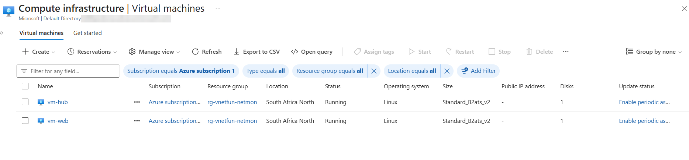
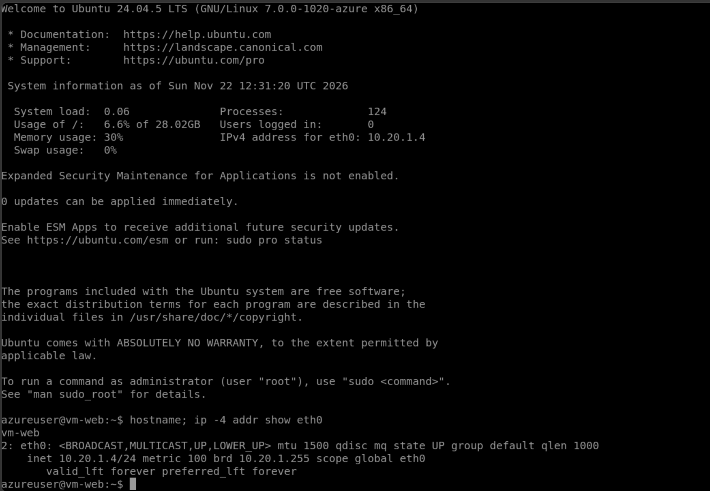
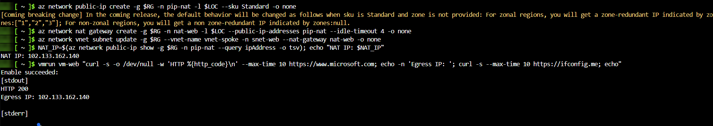
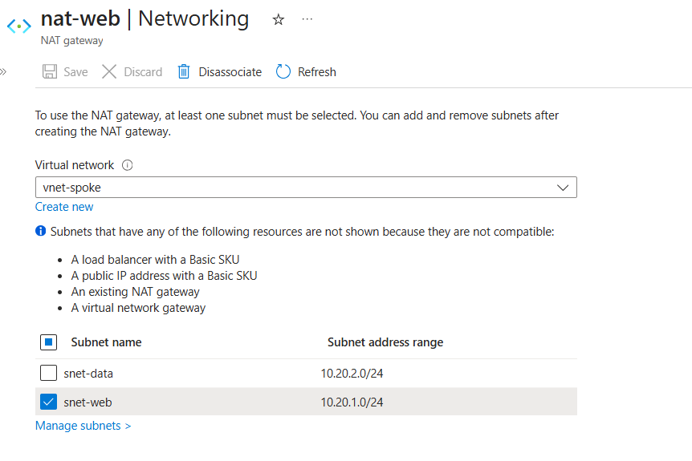
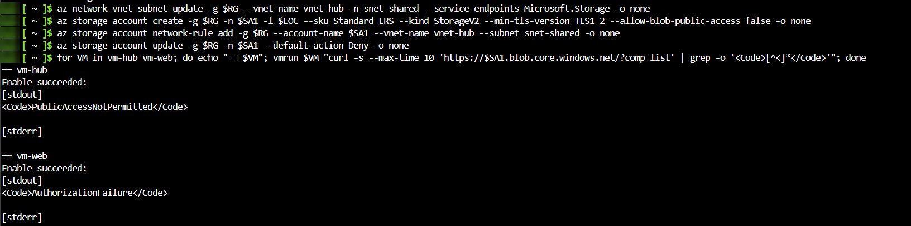
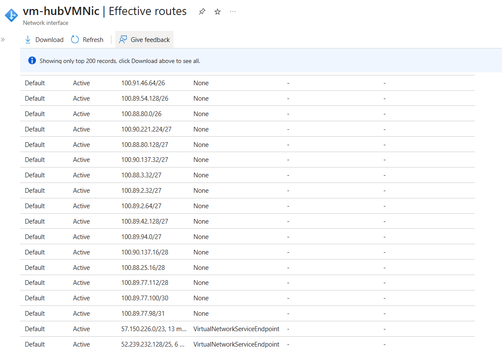
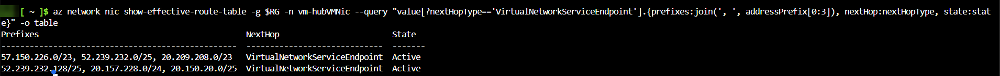

## Environment setup

Lab variables are stored in a local env file and loaded 
into Cloud Shell:

```bash
# Variables used 
RG=rg-vnetfun-netmon
LOC=southafricanorth
SA1=stsvcep2648
SA2=stpe2468
VMSIZE=Standard_B2ats_v2
ADMIN=azureuser
```

The VM admin password is read with `read -s` at the start of each session, so it never lands in the env file, shell history or the repo.

```bash
# Load variables
source ~/vnetfun.env

# Verify
echo $RG   # rg-vnetfun-netmon
echo $LOC  # southafricanorth
```

This setup keeps creds out of source control 
while making commands repeatable across sessions.


## 4.1 Virtual Networks, Peering, Public IPs and Routing

### What I built
- Hub VNet (10.10.0.0/16) with a shared subnet and a dedicated AzureBastionSubnet
- Spoke VNet (10.20.0.0/16) with a web subnet and a data subnet
- Bidirectional VNet peering between hub and spoke
- Two VMs with no public IPs (admin access via Bastion only): one in the hub, one in the spoke web subnet
- Azure Bastion Basic in the hub, reaching a spoke VM across the peering (deployed briefly, then deleted to stop the hourly charge)
- NAT gateway on the spoke web subnet for controlled outbound access
- UDR experiment: blackholed hub-bound traffic, proved it with Next hop, removed it
- A storage account locked to the hub's shared subnet with a **service endpoint**
- A second storage account with public access disabled, reachable only through a **private endpoint** in the spoke data subnet and private DNS, tested from the hub VM across the peering

### Why I made these decisions
- Hub-spoke separates shared services (Bastion, DNS) from workloads
- No public IPs on VMs reduces the attack surface
- NAT gateway gives predictable outbound with a single static IP rather than per-VM public IPs
- UDR next hop None proves you can inspect and override Azure's system routes
- Two VMs instead of the planned three: the small B-series sizes had no capacity in South Africa North and the subscription allows 4 vCPUs per region, so 2 x B2ats_v2 is the limit. The hub VM covers the storage tests instead (see [troubleshooting.md](troubleshooting.md))
- Bastion Basic, not the free Developer tier, because Developer doesn't support connecting to VMs in peered VNets
- Service endpoint vs private endpoint side by side: a service endpoint keeps the storage public endpoint but only admits chosen subnets; a private endpoint gives storage a private IP inside the VNet and lets public access be switched off entirely

### Commands run
See [commands.sh](commands.sh).

### Verification evidence
| Check | Expected | Result |
|-------|----------|--------|
| Resource group | Succeeded, southafricanorth | Created in southafricanorth |
| VNets | 10.10.0.0/16 and 10.20.0.0/16 | Hub 10.10.0.0/16, spoke 10.20.0.0/16, no overlap |
| Peering state | Connected both sides | Connected and FullyInSync on hub-to-spoke and spoke-to-hub |
| VMs | Running, no public IP | vm-hub 10.10.1.4 and vm-web 10.20.1.4, running, no public IP; spoke-to-hub ping 0% loss |
| NAT gateway | Attached to snet-web | nat-web on snet-web with pip-nat (Standard) |
| Outbound from VM | HTTP 200 after NAT gateway | HTTP 000 before, HTTP 200 after; egress IP = NAT IP |
| UDR next hop | None while attached, peering route after removal | None (rt-web) with 100% ping loss; VirtualNetworkPeering and 0% loss after removal |
| Service endpoint | Storage reachable from snet-shared only | vm-hub passes the firewall (PublicAccessNotPermitted); vm-web blocked (AuthorizationFailure) |
| Private endpoint | Name resolves to 10.20.2.x inside the VNet, public access refused | 10.20.2.4 from vm-hub (across the peering), 20.209.131.33 from the internet; AuthorizationFailure from the internet |
| Cleanup | Resource group deleted | `az group delete` accepted; resource group showing Deleting |

#### Screenshots
Subscription IDs, tenant names and account names are blurred.

| # | Step | What it shows |
|---|------|---------------|
| 01 | Setup | Resource group in South Africa North: both VNets, both VMs with their disks and NICs, and no public IP resources |
| 02 | VNets | Spoke subnets: 251 usable IPs per /24 (Azure reserves 5) |
| 03a / 03b | Peering | hub-to-spoke and spoke-to-hub, both Connected and Fully Synchronized |
| 04 | VMs | Both VMs running with an empty Public IP address column |
| 05 | Bastion | SSH session to vm-web (spoke) through Bastion Basic in the hub, across the peering |
| 06 | Outbound | vm-web on a private subnet: `HTTP 000`, no internet access |
| 07 | Outbound | After the NAT gateway: `HTTP 200`, egress IP equals the NAT public IP |
| 08 | NAT gateway | nat-web attached to snet-web only |
| 09 | UDR | Next hop from vm-web to vm-hub is **None**, caused by route table rt-web |
| 10 | UDR | Route table removed: next hop is **VirtualNetworkPeering** (System Route) again |
| 11 | Service endpoint | Same request: vm-hub passes the storage firewall (`PublicAccessNotPermitted`), vm-web is blocked (`AuthorizationFailure`) |
| 12 | Service endpoint | Storage firewall: selected networks only, vnet-hub allowed |
| 13a / 13b | Service endpoint | vm-hub's effective routes include `VirtualNetworkServiceEndpoint` next hops for Storage address ranges (portal, then filtered in the CLI) |
| 14 | Private endpoint | SA2 resolves to its public IP from the internet and to 10.20.2.4 from vm-hub; anonymous internet request refused |
| 15 | Private endpoint | pe-sa2 DNS configuration: NIC at 10.20.2.4, A record in privatelink.blob.core.windows.net via zone group |
| 16 | Cleanup | Resource group deleting |















Full command outputs for every step: [evidence/outputs.md](evidence/outputs.md)

### What I learned
- **Peering is two links and non-transitive.** Each side shows Connected only once both links exist, and A-B plus B-C does not give A-C.
- **Azure reserves 5 IPs per subnet.** The portal showed 251 usable in each /24, and every VM and the private endpoint took `.4`, the first free address. A /26 gives 59 usable.
- **Private subnets have no internet by default.** vm-web returned `HTTP 000` until a NAT gateway was attached to its subnet; then `HTTP 200`, with every request leaving from the NAT gateway's single static IP. Nothing on the VM changed.
- **A UDR with next hop None silently drops traffic.** Ping showed 100% loss with no ICMP error; Next hop named the route table responsible. A user route beats the system peering route for the same prefix, and removing it restored `VirtualNetworkPeering`.
- **Diagnostics can lag a change.** Next hop still said None for about a minute after the route table was removed, while ping already worked. Re-check a minute later before trusting a diagnostic over a live test.
- **Bastion Developer doesn't work across peering.** Reaching a spoke VM from a hub Bastion needed the Basic tier, which is billed by the hour, so it was created, used and deleted inside 20 minutes.
- **Run Command manages VMs without any network path.** It goes through the VM agent, so VMs with no public IP and no Bastion could still be tested.
- **Service endpoint vs private endpoint.** A service endpoint keeps the storage public endpoint but lets the storage firewall allow a subnet by name (vm-hub passed, vm-web got `AuthorizationFailure`). A private endpoint gives storage a private IP in the VNet (`10.20.2.4`) and lets public access be turned off completely.
- **Private endpoints depend on DNS.** The same name resolved to a public IP from the internet and to `10.20.2.4` inside the VNets, because a private DNS zone was linked to **both** VNets. The zone group created the A record automatically.
- **Read the error code, not just "it failed".** `PublicAccessNotPermitted` (passed the firewall, no anonymous access) and `AuthorizationFailure` (blocked by the firewall) look similar but mean different layers.
- **Capacity and quota are different problems.** B1s, B1ms and B1ls were out of capacity in South Africa North (Azure's side, temporary); the subscription's 4 vCPU regional quota capped the lab at two 2-vCPU VMs (the subscription's limit, changed only by request).
- **Standard public IPs are static by default; Basic SKU is retired.** NAT gateway and Bastion both require Standard.

### Reference
- [Virtual network peering](https://learn.microsoft.com/en-us/azure/virtual-network/virtual-network-peering-overview)
- [Default outbound access and private subnets](https://learn.microsoft.com/en-us/azure/virtual-network/ip-services/default-outbound-access)
- [NAT gateway](https://learn.microsoft.com/en-us/azure/nat-gateway/nat-overview)
- [Virtual network traffic routing](https://learn.microsoft.com/en-us/azure/virtual-network/virtual-networks-udr-overview)
- [Network Watcher next hop](https://learn.microsoft.com/en-us/azure/network-watcher/next-hop-overview)
- [Azure Bastion SKU comparison](https://learn.microsoft.com/en-us/azure/bastion/bastion-sku-comparison)
- [Virtual network service endpoints](https://learn.microsoft.com/en-us/azure/virtual-network/virtual-network-service-endpoints-overview)
- [Private endpoint DNS configuration](https://learn.microsoft.com/en-us/azure/private-link/private-endpoint-dns)

