# Lab 4.1 command outputs

Captured from Azure Cloud Shell (Bash). Subscription IDs, tenant names and account names are replaced with placeholders; long outputs are trimmed to the fields that prove the result (marked `...`).

Commands for every step: [commands.sh](../commands.sh)

## Step 0: Variables

```bash
cat > ~/vnetfun.env <<'EOF'
RG=rg-vnetfun-netmon
LOC=southafricanorth
SA1=stsvcep2648
SA2=stpe2468
VMSIZE=Standard_B2ats_v2
ADMIN=azureuser
EOF
source ~/vnetfun.env
read -s -p "VM admin password: " VMPW; echo
```

No output. The variables live in a local env file, and the VM password is read with `read -s`, so it never appears on screen, in shell history or in the repo.

## Step 1: Resource group, hub and spoke VNets

```bash
az group create -n $RG -l $LOC -o table
```

```text
Location          Name
----------------  -----------------
southafricanorth  rg-vnetfun-netmon
```

```bash
az network vnet subnet list -g $RG --vnet-name vnet-hub   --query "[].{name:name, prefix:addressPrefix, defaultOutbound:defaultOutboundAccess}" -o table
```

```text
Name                Prefix         DefaultOutbound
------------------  -------------  -----------------
snet-shared         10.10.1.0/24   False
AzureBastionSubnet  10.10.254.0/26
```

```bash
az network vnet subnet list -g $RG --vnet-name vnet-spoke --query "[].{name:name, prefix:addressPrefix, defaultOutbound:defaultOutboundAccess}" -o table
```

```text
Name       Prefix        DefaultOutbound
---------  ------------  -----------------
snet-web   10.20.1.0/24  False
snet-data  10.20.2.0/24  True
```

**What this proves**
- Two VNets with address spaces that don't overlap (10.10.0.0/16 hub, 10.20.0.0/16 spoke). Peering is refused between overlapping ranges, so this is decided before anything else is built.
- `AzureBastionSubnet` uses the exact name Azure requires and is a /26, the minimum size for Bastion Basic and above.
- `snet-web` and `snet-shared` are **private subnets** (`DefaultOutbound: False`): VMs in them get no implicit internet access. `snet-data` explicitly keeps default outbound so the storage endpoint tests later aren't affected by it. `AzureBastionSubnet` shows no value because the setting was left at the platform default.
- The portal shows **251 available IPs** in each /24: 256 addresses minus the 5 Azure reserves in every subnet (network address, default gateway, two for Azure DNS, and broadcast).

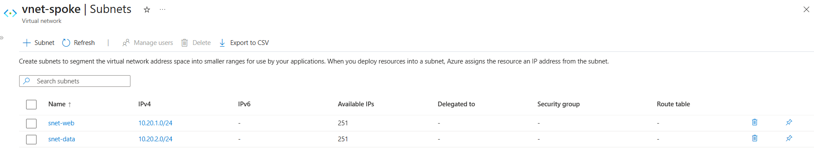

## Step 2: Peering

```bash
az network vnet peering list -g $RG --vnet-name vnet-hub   --query "[].{name:name, state:peeringState, sync:peeringSyncLevel}" -o table
```

```text
Name          State      Sync
------------  ---------  -----------
hub-to-spoke  Connected  FullyInSync
```

```bash
az network vnet peering list -g $RG --vnet-name vnet-spoke --query "[].{name:name, state:peeringState, sync:peeringSyncLevel}" -o table
```

```text
Name          State      Sync
------------  ---------  -----------
spoke-to-hub  Connected  FullyInSync
```

**What this proves**
- Peering is **two links, one in each direction**. Each side shows `Connected` only once both links exist; with just one created, its state stays `Initiated`.
- `FullyInSync` means both VNets have the other's current address space. If a VNet's address space changes later, the peering has to be synced again.
- **Virtual network gateway: Disabled** on both sides: no gateway transit, so the spoke only reaches the hub itself. Peering is also **non-transitive**, so a second spoke peered to the hub would not reach this spoke without extra routing.
- **Cross-tenant: No**: both VNets are in the same subscription and tenant.


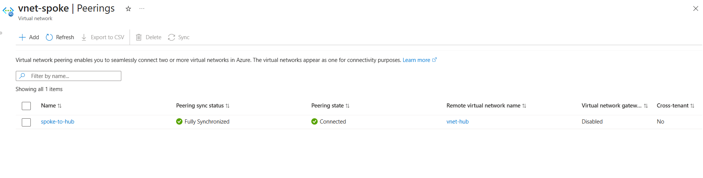

## Step 3: Two VMs with no public IP

```bash
az vm list -g $RG -d --query "[].{name:name, size:hardwareProfile.vmSize, state:powerState, privateIp:privateIps, publicIp:publicIps}" -o table
```

```text
Name    Size               State       PrivateIp    PublicIp
------  -----------------  ----------  -----------  ----------
vm-hub  Standard_B2ats_v2  VM running  10.10.1.4
vm-web  Standard_B2ats_v2  VM running  10.20.1.4
```

```bash
vmrun vm-web "ping -c 3 -W 2 $HUB_IP"
```

```text
Enable succeeded:
[stdout]
PING 10.10.1.4 (10.10.1.4) 56(84) bytes of data.
64 bytes from 10.10.1.4: icmp_seq=1 ttl=64 time=1.63 ms
64 bytes from 10.10.1.4: icmp_seq=2 ttl=64 time=1.83 ms
64 bytes from 10.10.1.4: icmp_seq=3 ttl=64 time=1.01 ms

--- 10.10.1.4 ping statistics ---
3 packets transmitted, 3 received, 0% packet loss, time 2004ms
rtt min/avg/max/mdev = 1.008/1.486/1.826/0.348 ms
```

**What this proves**
- Both VMs are running with **no public IP** (empty `PublicIp` column), and the resource group contains no Public IP address resources at all: there is no direct path in from the internet.
- Each VM got the **first usable address** in its subnet, `.4`: `.0` to `.3` are reserved by Azure (network, gateway, DNS), which is where the 5 reserved IPs from step 1 go (plus `.255` for broadcast).
- The spoke VM reached the hub VM (`0% packet loss`, about 1.5 ms) across the **peering**: traffic between peered VNets uses Microsoft's backbone with private IPs only.
- `ttl=64` (unchanged from Linux's default) shows there was no router hop in between: peered VNets behave like one network.
- The ping ran through **Run Command**, which goes through the VM agent and the Azure platform, not the network. That's how a VM with no public IP and no Bastion can still be managed.
- Two VMs, not three: see [troubleshooting.md](../troubleshooting.md) entries 2 and 3 (capacity and the 4 vCPU quota).

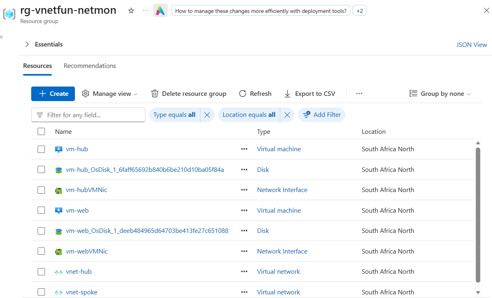
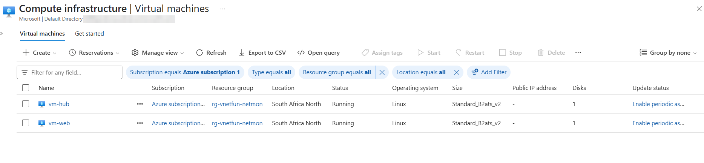

## Step 5: Bastion Basic (created, used, deleted)

```bash
az network public-ip create -g $RG -n pip-bastion -l $LOC --sku Standard -o none
az network bastion create -g $RG -n bas-hub -l $LOC --vnet-name vnet-hub \
  --public-ip-address pip-bastion --sku Basic -o none
# connected to vm-web from the portal, then:
az network bastion delete -g $RG -n bas-hub
az network public-ip delete -g $RG -n pip-bastion
```

```text
<paste output from the SSH session: hostname; ip -4 addr show eth0>
```

**What this proves**
- 

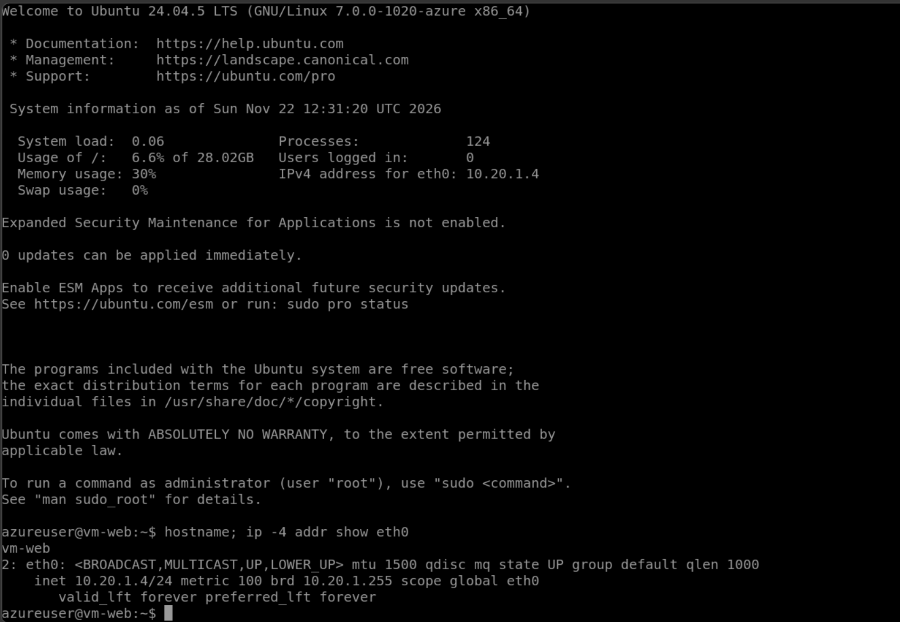

## Step 6: Outbound blocked, then fixed by a NAT gateway

**Before the NAT gateway**

```bash
vmrun vm-web "curl -s -o /dev/null -w 'HTTP %{http_code}\n' --max-time 10 https://www.microsoft.com"
```

```text
<paste output>
```

**After the NAT gateway**

```bash
echo "NAT IP: $NAT_IP"
vmrun vm-web "curl -s -o /dev/null -w 'HTTP %{http_code}\n' --max-time 10 https://www.microsoft.com; echo -n 'Egress IP: '; curl -s --max-time 10 https://ifconfig.me; echo"
```

```text
<paste output>
```

**What this proves**
- 
- 


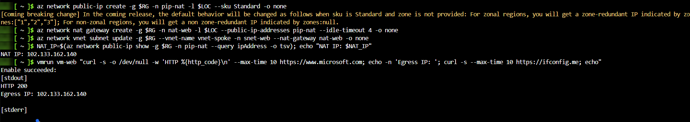
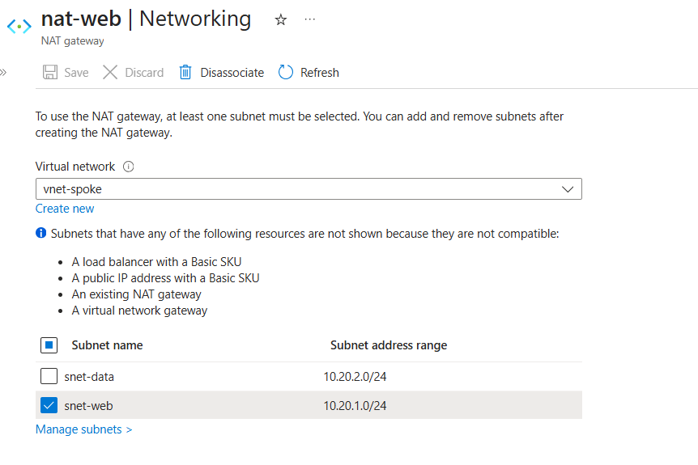

## Step 7: UDR blackhole, proved and removed

**With the route table attached**

```bash
az network watcher show-next-hop -g $RG --vm vm-web --source-ip $WEB_IP --dest-ip $HUB_IP -o table
vmrun vm-web "ping -c 3 -W 2 $HUB_IP"
```

```text
<paste output>
```

**After removing it**

```bash
az network watcher show-next-hop -g $RG --vm vm-web --source-ip $WEB_IP --dest-ip $HUB_IP -o table
vmrun vm-web "ping -c 3 -W 2 $HUB_IP"
```

```text
<paste output>
```

**What this proves**
- 
- 

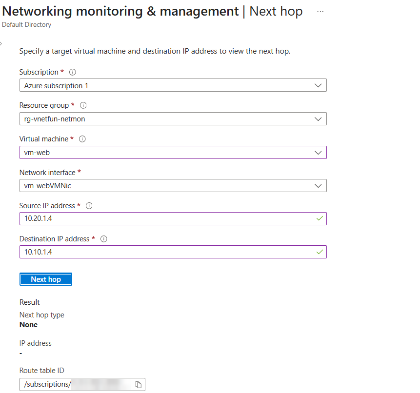
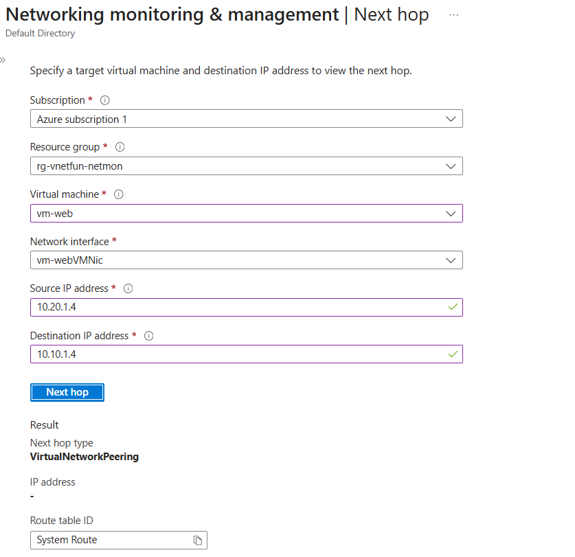

## Step 8: Service endpoint (SA1, allowed from the hub subnet only)

```bash
for VM in vm-hub vm-web; do echo "== $VM"; vmrun $VM "curl -s --max-time 10 'https://$SA1.blob.core.windows.net/?comp=list' | grep -o '<Code>[^<]*</Code>'"; done
```

```text
<paste output>
```

**What this proves**
- 
- 

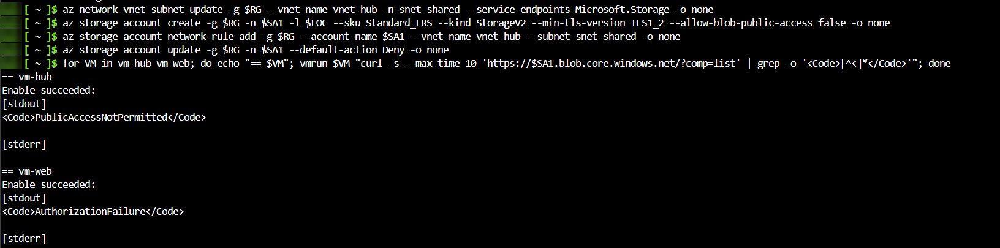

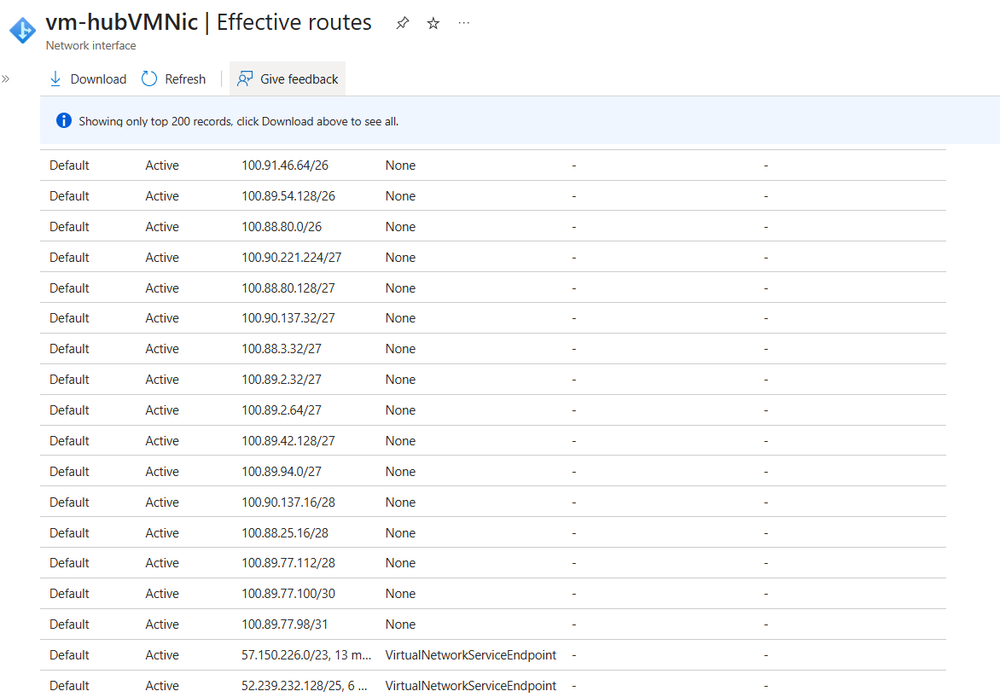

## Step 9: Private endpoint (SA2)

```bash
nslookup $SA2.blob.core.windows.net | tail -n 4
vmrun vm-hub "getent hosts $SA2.blob.core.windows.net"
curl -s --max-time 10 "https://$SA2.blob.core.windows.net/?comp=list" | grep -o '<Code>[^<]*</Code>'
```

```text
<paste output>
```

**What this proves**
- 
- 


## Step 10: Cleanup

```bash
az group delete -n $RG --yes --no-wait
```

```text
<paste output, or note "no output">
```

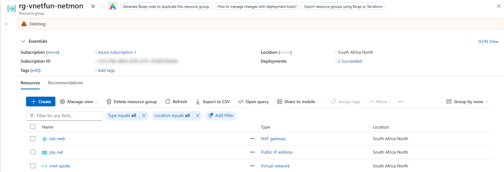
