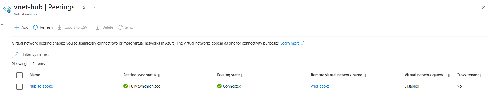
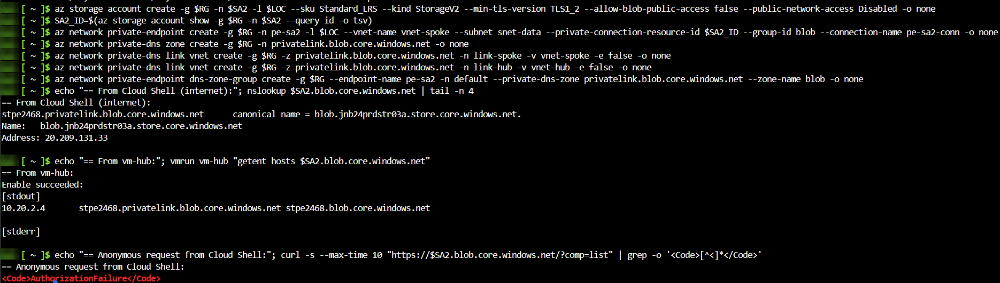
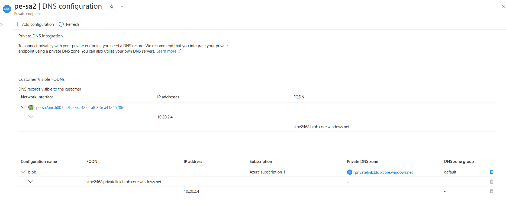

# Lab 4.1 command outputs

Captured from Azure Cloud Shell (Bash). Subscription IDs, tenant names and account names are replaced with placeholders; long outputs are trimmed to the fields that prove the result (marked `...`).

Commands for every step: [commands.sh](../commands.sh)

## Step 0: Variables

```bash
cat > ~/vnetfun.env <<'EOF'
RG=rg-vnetfun-netmon
LOC=southafricanorth
SA1=stsvcep2648
SA2=stpe2468
VMSIZE=Standard_B2ats_v2
ADMIN=azureuser
EOF
source ~/vnetfun.env
read -s -p "VM admin password: " VMPW; echo
```

No output. The variables live in a local env file, and the VM password is read with `read -s`, so it never appears on screen, in shell history or in the repo.

## Step 1: Resource group, hub and spoke VNets

```bash
az group create -n $RG -l $LOC -o table
```

```text
Location          Name
----------------  -----------------
southafricanorth  rg-vnetfun-netmon
```

```bash
az network vnet subnet list -g $RG --vnet-name vnet-hub   --query "[].{name:name, prefix:addressPrefix, defaultOutbound:defaultOutboundAccess}" -o table
```

```text
Name                Prefix         DefaultOutbound
------------------  -------------  -----------------
snet-shared         10.10.1.0/24   False
AzureBastionSubnet  10.10.254.0/26
```

```bash
az network vnet subnet list -g $RG --vnet-name vnet-spoke --query "[].{name:name, prefix:addressPrefix, defaultOutbound:defaultOutboundAccess}" -o table
```

```text
Name       Prefix        DefaultOutbound
---------  ------------  -----------------
snet-web   10.20.1.0/24  False
snet-data  10.20.2.0/24  True
```

**What this proves**
- Two VNets with address spaces that don't overlap (10.10.0.0/16 hub, 10.20.0.0/16 spoke). Peering is refused between overlapping ranges, so this is decided before anything else is built.
- `AzureBastionSubnet` uses the exact name Azure requires and is a /26, the minimum size for Bastion Basic and above.
- `snet-web` and `snet-shared` are **private subnets** (`DefaultOutbound: False`): VMs in them get no implicit internet access. `snet-data` explicitly keeps default outbound so the storage endpoint tests later aren't affected by it. `AzureBastionSubnet` shows no value because the setting was left at the platform default.
- The portal shows **251 available IPs** in each /24: 256 addresses minus the 5 Azure reserves in every subnet (network address, default gateway, two for Azure DNS, and broadcast).


## Step 2: Peering

```bash
az network vnet peering list -g $RG --vnet-name vnet-hub   --query "[].{name:name, state:peeringState, sync:peeringSyncLevel}" -o table
```

```text
Name          State      Sync
------------  ---------  -----------
hub-to-spoke  Connected  FullyInSync
```

```bash
az network vnet peering list -g $RG --vnet-name vnet-spoke --query "[].{name:name, state:peeringState, sync:peeringSyncLevel}" -o table
```

```text
Name          State      Sync
------------  ---------  -----------
spoke-to-hub  Connected  FullyInSync
```

**What this proves**
- Peering is **two links, one in each direction**. Each side shows `Connected` only once both links exist; with just one created, its state stays `Initiated`.
- `FullyInSync` means both VNets have the other's current address space. If a VNet's address space changes later, the peering has to be synced again.
- **Virtual network gateway: Disabled** on both sides: no gateway transit, so the spoke only reaches the hub itself. Peering is also **non-transitive**, so a second spoke peered to the hub would not reach this spoke without extra routing.
- **Cross-tenant: No**: both VNets are in the same subscription and tenant.




## Step 3: Two VMs with no public IP

```bash
az vm list -g $RG -d --query "[].{name:name, size:hardwareProfile.vmSize, state:powerState, privateIp:privateIps, publicIp:publicIps}" -o table
```

```text
Name    Size               State       PrivateIp    PublicIp
------  -----------------  ----------  -----------  ----------
vm-hub  Standard_B2ats_v2  VM running  10.10.1.4
vm-web  Standard_B2ats_v2  VM running  10.20.1.4
```

```bash
vmrun vm-web "ping -c 3 -W 2 $HUB_IP"
```

```text
Enable succeeded:
[stdout]
PING 10.10.1.4 (10.10.1.4) 56(84) bytes of data.
64 bytes from 10.10.1.4: icmp_seq=1 ttl=64 time=1.63 ms
64 bytes from 10.10.1.4: icmp_seq=2 ttl=64 time=1.83 ms
64 bytes from 10.10.1.4: icmp_seq=3 ttl=64 time=1.01 ms

--- 10.10.1.4 ping statistics ---
3 packets transmitted, 3 received, 0% packet loss, time 2004ms
rtt min/avg/max/mdev = 1.008/1.486/1.826/0.348 ms
```

**What this proves**
- Both VMs are running with **no public IP** (empty `PublicIp` column), and the resource group contains no Public IP address resources at all: there is no direct path in from the internet.
- Each VM got the **first usable address** in its subnet, `.4`: `.0` to `.3` are reserved by Azure (network, gateway, DNS), which is where the 5 reserved IPs from step 1 go (plus `.255` for broadcast).
- The spoke VM reached the hub VM (`0% packet loss`, about 1.5 ms) across the **peering**: traffic between peered VNets uses Microsoft's backbone with private IPs only.
- `ttl=64` (unchanged from Linux's default) shows there was no router hop in between: peered VNets behave like one network.
- The ping ran through **Run Command**, which goes through the VM agent and the Azure platform, not the network. That's how a VM with no public IP and no Bastion can still be managed.
- Two VMs, not three: see [troubleshooting.md](../troubleshooting.md) entries 2 and 3 (capacity and the 4 vCPU quota).


## Step 4: Network Watcher

```bash
az network watcher configure -g NetworkWatcherRG -l $LOC --enabled true -o none
```

No output (`-o none`). Network Watcher is enabled per region and is free; it's needed for the Next hop checks in step 7.

## Step 5: Bastion Basic (created, used, deleted)

```bash
az network public-ip create -g $RG -n pip-bastion -l $LOC --sku Standard -o none
az config set extension.use_dynamic_install=yes_without_prompt
az network bastion create -g $RG -n bas-hub -l $LOC --vnet-name vnet-hub \
  --public-ip-address pip-bastion --sku Basic -o none
az network bastion list -g $RG --query "[].{name:name, state:provisioningState, sku:sku.name}" -o table
```

```text
Name     State      Sku
-------  ---------  -----
bas-hub  Succeeded  Basic
```

Connected from the portal (vm-web > Connect > Connect via Bastion, password authentication), then in the browser session:

```text
azureuser@vm-web:~$ hostname; ip -4 addr show eth0
vm-web
2: eth0: <BROADCAST,MULTICAST,UP,LOWER_UP> mtu 1500 qdisc mq state UP group default qlen 1000
    inet 10.20.1.4/24 metric 100 brd 10.20.1.255 scope global eth0
       valid_lft forever preferred_lft forever
```

```bash
az network bastion delete -g $RG -n bas-hub
az network public-ip delete -g $RG -n pip-bastion
```

**What this proves**
- An interactive SSH session to **vm-web (10.20.1.4, spoke)** through a Bastion host that lives in the **hub**: Bastion reached the VM across the peering. This is why the lab uses **Basic**; the free Developer tier doesn't support peered VNets.
- The VM still has **no public IP**. The only public IP belonged to Bastion, and the session ran over HTTPS (443) in the browser, so no SSH or RDP port is ever exposed to the internet.
- Bastion needs its own `AzureBastionSubnet` (/26 or larger) and a Standard public IP, both prepared in step 1.
- Bastion was deleted straight after the screenshot: it's billed per hour whether or not anyone is connected.
- `ip -4 addr` shows `10.20.1.255` as the broadcast address, one of the 5 addresses Azure reserves in the subnet.


Confirmed both were gone before moving on:

```bash
az network bastion list -g $RG -o table
az network public-ip list -g $RG -o table
```

Both returned nothing. Bastion existed for about 20 minutes.

## Step 6: Outbound blocked, then fixed by a NAT gateway

**Before the NAT gateway**

```bash
vmrun vm-web "curl -s -o /dev/null -w 'HTTP %{http_code}\n' --max-time 10 https://www.microsoft.com"
```

```text
Enable succeeded:
[stdout]
HTTP 000

[stderr]
```

`HTTP 000` means curl never got a response: it gave up after the 10-second `--max-time`.

**After the NAT gateway**

```bash
az network public-ip create -g $RG -n pip-nat -l $LOC --sku Standard -o none
az network nat gateway create -g $RG -n nat-web -l $LOC --public-ip-addresses pip-nat --idle-timeout 4 -o none
az network vnet subnet update -g $RG --vnet-name vnet-spoke -n snet-web --nat-gateway nat-web -o none
NAT_IP=$(az network public-ip show -g $RG -n pip-nat --query ipAddress -o tsv); echo "NAT IP: $NAT_IP"
vmrun vm-web "curl -s -o /dev/null -w 'HTTP %{http_code}\n' --max-time 10 https://www.microsoft.com; echo -n 'Egress IP: '; curl -s --max-time 10 https://ifconfig.me; echo"
```

```text
NAT IP: 102.133.162.140
Enable succeeded:
[stdout]
HTTP 200
Egress IP: 102.133.162.140

[stderr]
```

**What this proves**
- **Before:** `HTTP 000`. snet-web is a private subnet (`defaultOutboundAccess: false`, step 1), so a VM there with no public IP has **no internet access at all**. Since September 2025, new VNets default to this behaviour; the old "default outbound access" is retired for them.
- **After:** `HTTP 200` with no change to the VM. Only the **subnet** changed: attaching the NAT gateway gave every VM in snet-web outbound access.
- The **egress IP matches the NAT gateway's public IP** (`102.133.162.140`): all outbound traffic from the subnet leaves from one static, predictable address. That's what you'd give a partner to allow-list.
- NAT gateway is **outbound only**: connections can't be started from the internet to the VM through it, so the VM is still unreachable from outside.
- The portal shows the NAT gateway is attached to **snet-web only**; snet-data isn't affected.
- `pip-nat` is a **Standard** SKU public IP (static by default). NAT gateway doesn't accept Basic SKU IPs, which are retired anyway.


## Step 7: UDR blackhole, proved and removed

**With the route table attached**

```bash
az network route-table create -g $RG -n rt-web -l $LOC -o none
az network route-table route create -g $RG --route-table-name rt-web -n hub-blackhole --address-prefix 10.10.0.0/16 --next-hop-type None -o none
az network vnet subnet update -g $RG --vnet-name vnet-spoke -n snet-web --route-table rt-web -o none
az network watcher show-next-hop -g $RG --vm vm-web --source-ip $WEB_IP --dest-ip $HUB_IP -o table
```

```text
NextHopType    RouteTableId
-------------  --------------------------------------------------------------------------------------------------
None           /subscriptions/<subscription-id>/resourceGroups/rg-vnetfun-netmon/providers/Microsoft.Network/routeTables/rt-web
```

```bash
vmrun vm-web "ping -c 3 -W 2 $HUB_IP"
```

```text
Enable succeeded:
[stdout]
PING 10.10.1.4 (10.10.1.4) 56(84) bytes of data.

--- 10.10.1.4 ping statistics ---
3 packets transmitted, 0 received, 100% packet loss, time 2045ms

[stderr]
```

> In the portal's Next hop tool, the **source** VM must be the one sending the traffic (vm-web). Selecting vm-hub returned `DestinationIpMatchedToNicIp`: the destination can't be the selected VM's own IP.

**After removing it**

```bash
az network vnet subnet update -g $RG --vnet-name vnet-spoke -n snet-web --remove routeTable -o none
vmrun vm-web "ping -c 3 -W 2 $HUB_IP"
```

```text
Enable succeeded:
[stdout]
PING 10.10.1.4 (10.10.1.4) 56(84) bytes of data.
64 bytes from 10.10.1.4: icmp_seq=1 ttl=64 time=1.45 ms
64 bytes from 10.10.1.4: icmp_seq=2 ttl=64 time=1.00 ms
64 bytes from 10.10.1.4: icmp_seq=3 ttl=64 time=1.07 ms

--- 10.10.1.4 ping statistics ---
3 packets transmitted, 3 received, 0% packet loss, time 2003ms
rtt min/avg/max/mdev = 1.000/1.173/1.452/0.198 ms

[stderr]
```

Next hop, checked again a minute later in the portal (Network Watcher > Next hop, vm-web, 10.20.1.4 to 10.10.1.4):

```text
Next hop type:  VirtualNetworkPeering
IP address:     -
Route table ID: System Route
```

The same check from the CLI, plus the NIC's effective routes for the hub range:

```bash
az network watcher show-next-hop -g $RG --vm vm-web --source-ip $WEB_IP --dest-ip $HUB_IP -o table
az network nic show-effective-route-table -g $RG -n vm-webVMNic \
  --query "value[?contains(addressPrefix[0],'10.10')].{prefix:addressPrefix[0], nextHop:nextHopType, source:source, state:state}" -o table
```

```text
NextHopType            RouteTableId
---------------------  --------------
VirtualNetworkPeering  System Route

Prefix        NextHop      Source    State
------------  -----------  --------  -------
10.10.0.0/16  VNetPeering  Default   Active
```

The only route to the hub is now the **Default** (system) peering route, and it's **Active**. With the route table attached, a **User** route for the same prefix took priority over it.

> Run straight after removing the route table, `az network watcher show-next-hop` still returned `None` (with no route table ID) even though the ping already worked. The effective routes behind Next hop take a minute or two to refresh. See [troubleshooting.md](../troubleshooting.md) entry 6.

**What this proves**
- A **user-defined route** overrides Azure's **system routes**: the peering route to 10.10.0.0/16 still existed, but the more specific-or-equal user route with next hop `None` won, and Next hop named `rt-web` as the cause.
- Next hop `None` **drops packets silently**: the ping got no replies and no "destination unreachable" error, so to the VM it looks like the other side is down. That's why Next hop and effective routes are the first tools to reach for when traffic disappears.
- Removing the route table restored the **system route** (`VirtualNetworkPeering`, route table "System Route") and the ping came straight back: the UDR was the only thing blocking it.
- A route table is attached to a **subnet**, not a VM, so it affected every VM in snet-web and nothing in snet-data or the hub.


## Step 8: Service endpoint (SA1, allowed from the hub subnet only)

```bash
az network vnet subnet update -g $RG --vnet-name vnet-hub -n snet-shared --service-endpoints Microsoft.Storage -o none
az storage account create -g $RG -n $SA1 -l $LOC --sku Standard_LRS --kind StorageV2 --min-tls-version TLS1_2 --allow-blob-public-access false -o none
az storage account network-rule add -g $RG --account-name $SA1 --vnet-name vnet-hub --subnet snet-shared -o none
az storage account update -g $RG -n $SA1 --default-action Deny -o none
# about 60 seconds later:
for VM in vm-hub vm-web; do echo "== $VM"; vmrun $VM "curl -s --max-time 10 'https://$SA1.blob.core.windows.net/?comp=list' | grep -o '<Code>[^<]*</Code>'"; done
```

```text
== vm-hub
Enable succeeded:
[stdout]
<Code>PublicAccessNotPermitted</Code>

[stderr]

== vm-web
Enable succeeded:
[stdout]
<Code>AuthorizationFailure</Code>

[stderr]
```

**What this proves**
- The same anonymous request to the same storage account got **two different answers depending on which subnet it came from**.
- **vm-web: `AuthorizationFailure`.** The storage firewall (`--default-action Deny`) rejected it at the network level. vm-web's traffic arrives from the NAT gateway's public IP, which isn't on the account's allow-list.
- **vm-hub: `PublicAccessNotPermitted`.** The request **passed the firewall**, because snet-shared has a `Microsoft.Storage` service endpoint and is on the account's virtual network rules. It was refused one layer later, only because anonymous access is disabled on the account (`--allow-blob-public-access false`). With real credentials (Entra ID or a SAS), this request would succeed; from vm-web it never could.
- A service endpoint doesn't give the storage account a private IP: vm-hub still talks to the **public** endpoint `$SA1.blob.core.windows.net`. What changes is that traffic from the subnet travels over the Azure backbone and carries the subnet's identity, which the storage firewall can allow by name instead of by IP.
- Defence in depth: the network rule decides **where** a request may come from; authentication decides **who** may do what. Both have to pass.
- The storage account's **Networking** page shows public network access **enabled from selected networks** only, with one virtual network rule: **vnet-hub** (1 subnet, 10.10.0.0/16). No IP addresses are allowed.
- vm-hub's NIC now has **effective routes with next hop `VirtualNetworkServiceEndpoint`** for Azure Storage's public address ranges (for example `57.150.226.0/23` and `52.239.232.128/25`). Enabling the service endpoint on the subnet added these system routes; vm-web's subnet has none, so its storage traffic goes out through the NAT gateway instead.


## Step 9: Private endpoint (SA2)

```bash
nslookup $SA2.blob.core.windows.net | tail -n 4
vmrun vm-hub "getent hosts $SA2.blob.core.windows.net"
curl -s --max-time 10 "https://$SA2.blob.core.windows.net/?comp=list" | grep -o '<Code>[^<]*</Code>'
```

```text
<paste output>
```

**What this proves**
- 
- 




## Step 10: Cleanup

```bash
az group delete -n $RG --yes --no-wait
```

```text
<paste output, or note "no output">
```


