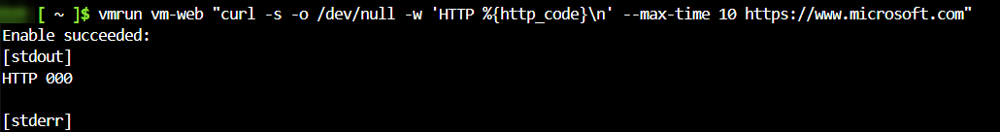
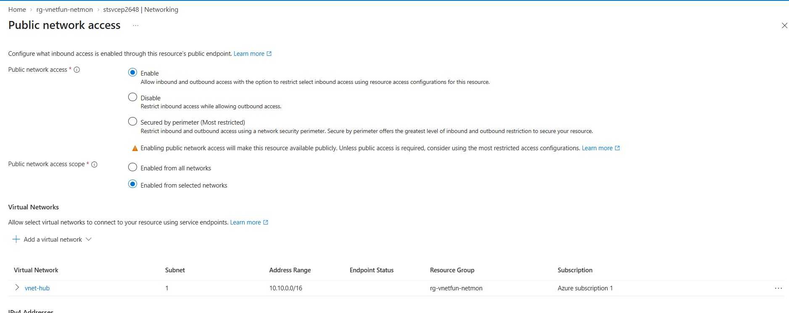

# Lab 4.1 command outputs

Captured from Azure Cloud Shell (Bash). Subscription IDs, tenant names and account names are replaced with placeholders; long outputs are trimmed to the fields that prove the result (marked `...`).

Commands for every step: [commands.sh](../commands.sh)

## Step 0: Variables

```bash
cat > ~/vnetfun.env <<'EOF'
RG=rg-vnetfun-netmon
LOC=southafricanorth
SA1=stsvcep2648
SA2=stpe2468
VMSIZE=Standard_B1s
ADMIN=azureuser
EOF
source ~/vnetfun.env
read -s -p "VM admin password: " VMPW; echo
```

No output. The variables live in a local env file, and the VM password is read with `read -s`, so it never appears on screen, in shell history or in the repo.

## Step 1: Resource group, hub and spoke VNets

```bash
az group create -n $RG -l $LOC -o table
az network vnet subnet list -g $RG --vnet-name vnet-hub   --query "[].{name:name, prefix:addressPrefix, defaultOutbound:defaultOutboundAccess}" -o table
az network vnet subnet list -g $RG --vnet-name vnet-spoke --query "[].{name:name, prefix:addressPrefix, defaultOutbound:defaultOutboundAccess}" -o table
```

```text
<paste output>
```

**What this proves**
- 
- 


## Step 2: Peering

```bash
az network vnet peering list -g $RG --vnet-name vnet-hub   --query "[].{name:name, state:peeringState, sync:peeringSyncLevel}" -o table
az network vnet peering list -g $RG --vnet-name vnet-spoke --query "[].{name:name, state:peeringState, sync:peeringSyncLevel}" -o table
```

```text
<paste output>
```

**What this proves**
- 


## Step 3: VMs with no public IP

```bash
az vm list -g $RG -d --query "[].{name:name, state:powerState, privateIp:privateIps, publicIp:publicIps}" -o table
vmrun vm-web "ping -c 3 -W 2 $HUB_IP"
```

```text
<paste output>
```

**What this proves**
- 
- 


## Step 5: Bastion Basic (created, used, deleted)

```bash
az network public-ip create -g $RG -n pip-bastion -l $LOC --sku Standard -o none
az network bastion create -g $RG -n bas-hub -l $LOC --vnet-name vnet-hub \
  --public-ip-address pip-bastion --sku Basic -o none
# connected to vm-web from the portal, then:
az network bastion delete -g $RG -n bas-hub
az network public-ip delete -g $RG -n pip-bastion
```

```text
<paste output from the SSH session: hostname; ip -4 addr show eth0>
```

**What this proves**
- 


## Step 6: Outbound blocked, then fixed by a NAT gateway

**Before the NAT gateway**

```bash
vmrun vm-web "curl -s -o /dev/null -w 'HTTP %{http_code}\n' --max-time 10 https://www.microsoft.com"
```

```text
<paste output>
```

**After the NAT gateway**

```bash
echo "NAT IP: $NAT_IP"
vmrun vm-web "curl -s -o /dev/null -w 'HTTP %{http_code}\n' --max-time 10 https://www.microsoft.com; echo -n 'Egress IP: '; curl -s --max-time 10 https://ifconfig.me; echo"
```

```text
<paste output>
```

**What this proves**
- 
- 




## Step 7: UDR blackhole, proved and removed

**With the route table attached**

```bash
az network watcher show-next-hop -g $RG --vm vm-web --source-ip $WEB_IP --dest-ip $HUB_IP -o table
vmrun vm-web "ping -c 3 -W 2 $HUB_IP"
```

```text
<paste output>
```

**After removing it**

```bash
az network watcher show-next-hop -g $RG --vm vm-web --source-ip $WEB_IP --dest-ip $HUB_IP -o table
vmrun vm-web "ping -c 3 -W 2 $HUB_IP"
```

```text
<paste output>
```

**What this proves**
- 
- 


## Step 8: Service endpoint (SA1)

```bash
for VM in vm-data vm-web; do echo "== $VM"; vmrun $VM "curl -s --max-time 10 'https://$SA1.blob.core.windows.net/?comp=list' | grep -o '<Code>[^<]*</Code>'"; done
```

```text
<paste output>
```

**What this proves**
- 
- 





## Step 9: Private endpoint (SA2)

```bash
nslookup $SA2.blob.core.windows.net | tail -n 4
vmrun vm-data "getent hosts $SA2.blob.core.windows.net"
curl -s --max-time 10 "https://$SA2.blob.core.windows.net/?comp=list" | grep -o '<Code>[^<]*</Code>'
```

```text
<paste output>
```

**What this proves**
- 
- 


## Step 10: Cleanup

```bash
az group delete -n $RG --yes --no-wait
```

```text
<paste output, or note "no output">
```


