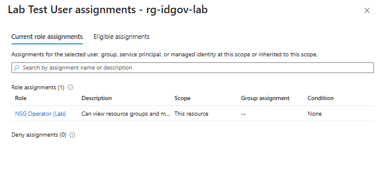
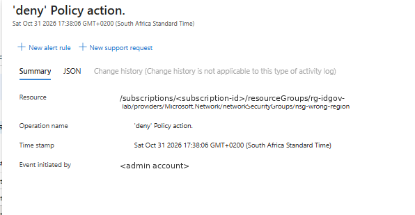

## 1.1 RBAC, Azure Policy, Tags and Resource Locks

### What I built
- Two resource groups in South Africa North: `rg-idgov-lab` (tagged `CostCentre=4410`) and `rg-idgov-locked`
- A cloud-only test user and a custom role, **NSG Operator (Lab)**, assignable only to `rg-idgov-lab`
- An **Allowed locations** policy on `rg-idgov-lab`, proved by trying to create an NSG in West Europe
- A **Modify** policy that copies `CostCentre` from the resource group to resources, with a remediation task for existing ones
- A **CanNotDelete** lock on one group and a **ReadOnly** lock on the other, each proved with a failed operation

### Why I made these decisions
- A custom role scoped to one resource group is least privilege: the user can manage NSGs there and nothing else, anywhere
- Policy controls *what* can exist; RBAC controls *who* can act. Even an Owner is blocked by the location policy
- Tags don't inherit by default, so the Modify policy plus remediation is how cost tags stay consistent
- Locks protect against mistakes by everyone, including Owners; ReadOnly is stricter than it sounds

### Commands run
See [commands.sh](commands.sh) and [nsg-operator.json](nsg-operator.json).

### Verification evidence
| Check | Expected | Result |
|-------|----------|--------|
| Custom role assignment | NSG Operator (Lab) on rg-idgov-lab only | One assignment at rg-idgov-lab (`--all` returns nothing else) |
| Check access (portal) | Test user shows the custom role, nothing inherited | NSG Operator (Lab), scope "This resource", 0 deny assignments |
| NSG outside South Africa North (UK South) | Denied: RequestDisallowedByPolicy | Denied: RequestDisallowedByPolicy, naming allowed-locations-rg1 |
| Existing NSG tags after remediation | CostCentre = 4410 | CostCentre = 4410 after remediation (1 of 1 deployments succeeded); Owner tag not copied |
| Delete NSG with CanNotDelete lock | Fails: ScopeLocked | Failed: ScopeLocked (lock inherited from rg-idgov-lab), even as Owner |
| Move NSG into ReadOnly group | Fails: move blocked by the lock | Failed at validation: ResourceMovePolicyValidationFailed > ScopeLocked (write blocked in rg-idgov-locked) |
| Cleanup | Both groups, role, user and policies removed | Completed with no errors: locks removed first, then policies, role assignment, custom role, test user and both groups |

Full command outputs for every step: [evidence/outputs.md](evidence/outputs.md)

### What I learned
- **Read the error code before trusting a negative test.** My first location test failed with `RequestDisallowedByAzure` (West Europe wasn't accepting new customers on my subscription), which looked like a pass but wasn't the policy at all. The real result was `RequestDisallowedByPolicy`, which names the assignment that blocked it.
- **RBAC decides who, Policy decides what.** As subscription Owner I had every permission to create an NSG, and the Allowed locations policy still blocked it in UK South.
- **Locks beat Owner.** A CanNotDelete lock on the resource group stopped me deleting the NSG inside it; locks are inherited by everything below the scope where they're set.
- **A move is a write.** Moving the NSG into a ReadOnly resource group failed at validation with `ScopeLocked ... cannot perform write operation`. A ReadOnly lock on either the source or the destination blocks a move.
- **CanNotDelete still allows changes.** It only stops deletes, so tag updates and policy remediation keep working underneath it.
- **Tags don't inherit.** The NSG had no tags even though its resource group was tagged `CostCentre=4410`; it took a Modify policy to copy the tag down.
- **Modify and DeployIfNotExists policies need a managed identity.** Assigning the tag policy created a system-assigned identity, and it needed the Tag Contributor role to be allowed to write tags.
- **Remediation only fixes what has already been evaluated.** My first remediation task finished with 0 deployments because the compliance scan hadn't run yet. Re-running it with `--resource-discovery-mode ReEvaluateCompliance` scans first, which can take 10-30 minutes on a new assignment.
- **Resource providers must be registered.** Remediation failed with `SubscriptionNotRegistered` until I registered `Microsoft.PolicyInsights` on the subscription.
- **A custom role's `assignableScopes` limits where it can be used.** The role definition lives at subscription level, but mine can only be assigned on one resource group. `az role assignment list --all` confirmed the test user had exactly one assignment, at that scope, and nothing inherited.
- **Disabled subscriptions are read-only**, and Cloud Shell needs to be in Bash for Bash scripts: my first two attempts failed on `ReadOnlyDisabledSubscription` and on PowerShell syntax errors.

### Reference
- [Create a custom role with the Azure CLI](https://learn.microsoft.com/en-us/azure/role-based-access-control/custom-roles-cli)
- [Assign a policy with the Azure CLI](https://learn.microsoft.com/en-us/azure/governance/policy/assign-policy-azurecli)
- [Remediate non-compliant resources](https://learn.microsoft.com/en-us/azure/governance/policy/how-to/remediate-resources)
- [Lock your resources](https://learn.microsoft.com/en-us/azure/azure-resource-manager/management/lock-resources)
