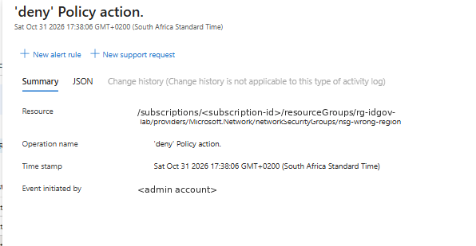

# Lab 1.1 command outputs

Captured from Azure Cloud Shell (Bash). Subscription IDs and account names are replaced with placeholders; long outputs are trimmed to the fields that prove the result (marked `...`).

## Step 0: Variables

```bash
cat > ~/idgov.env <<'EOF'
LOC=southafricanorth
RG1=rg-idgov-lab
RG2=rg-idgov-locked
NSG=nsg-idgov-test
EOF
source ~/idgov.env
SUB=$(az account show --query id -o tsv)
DOMAIN=$(az ad signed-in-user show --query userPrincipalName -o tsv | cut -d@ -f2)
UPN="labtest@$DOMAIN"
```

No output. The variables live in a local env file, so nothing tenant-specific is stored in the repo.

## Step 1: Resource groups and test NSG

```bash
az group create -n $RG1 -l $LOC --tags CostCentre=4410 Owner=Kat
az group create -n $RG2 -l $LOC
az network nsg create -g $RG1 -n $NSG -l $LOC
RG1_ID=$(az group show -n $RG1 --query id -o tsv)
```

**rg-idgov-lab**: created with the cost tags that the Modify policy will copy down later.

```json
{
  "id": "/subscriptions/<subscription-id>/resourceGroups/rg-idgov-lab",
  "location": "southafricanorth",
  "name": "rg-idgov-lab",
  "properties": { "provisioningState": "Succeeded" },
  "tags": { "CostCentre": "4410", "Owner": "Kat" }
}
```

**rg-idgov-locked**: the target for the ReadOnly lock and the move test.

```json
{
  "id": "/subscriptions/<subscription-id>/resourceGroups/rg-idgov-locked",
  "location": "southafricanorth",
  "name": "rg-idgov-locked",
  "properties": { "provisioningState": "Succeeded" },
  "tags": null
}
```

**nsg-idgov-test**: no custom rules, only the six defaults, and **no tags** even though its resource group is tagged.

```json
{
  "NewNSG": {
    "defaultSecurityRules": [
      { "name": "AllowVnetInBound",              "direction": "Inbound",  "priority": 65000, "access": "Allow" },
      { "name": "AllowAzureLoadBalancerInBound", "direction": "Inbound",  "priority": 65001, "access": "Allow" },
      { "name": "DenyAllInBound",                "direction": "Inbound",  "priority": 65500, "access": "Deny"  },
      { "name": "AllowVnetOutBound",             "direction": "Outbound", "priority": 65000, "access": "Allow" },
      { "name": "AllowInternetOutBound",         "direction": "Outbound", "priority": 65001, "access": "Allow" },
      { "name": "DenyAllOutBound",               "direction": "Outbound", "priority": 65500, "access": "Deny"  }
    ],
    "id": "/subscriptions/<subscription-id>/resourceGroups/rg-idgov-lab/providers/Microsoft.Network/networkSecurityGroups/nsg-idgov-test",
    "location": "southafricanorth",
    "provisioningState": "Succeeded",
    "securityRules": [],
    ...
  }
}
```

**What this proves**
- Both resource groups deployed in South Africa North.
- Tags on a resource group do **not** flow down to its resources: the NSG has no `tags` property. This is the baseline for the tag inheritance policy in step 6.
- A new NSG denies all inbound traffic from the internet but **allows outbound internet** by default (AllowInternetOutBound, priority 65001).

> Troubleshooting note: the first attempt failed with `ReadOnlyDisabledSubscription` because the original subscription was disabled, which makes it read-only. Switching to an active subscription fixed it. A second attempt failed because Cloud Shell was in PowerShell, which can't parse `VAR=value`, heredocs or `source`; switching to Bash fixed it.

## Step 2: Test user (cloud-only)

```bash
read -s -p "Temporary password for labtest: " PW; echo
az ad user create --display-name "Lab Test User" \
  --user-principal-name $UPN --password "$PW" \
  --force-change-password-next-sign-in true
```

```json
{
  "@odata.context": "https://graph.microsoft.com/v1.0/$metadata#users/$entity",
  "displayName": "Lab Test User",
  "id": "<object-id>",
  "givenName": null,
  "surname": null,
  "jobTitle": null,
  "mail": null,
  "userPrincipalName": "labtest@<tenant>.onmicrosoft.com"
}
```

**What this proves**
- A cloud-only user was created in Microsoft Entra ID through Microsoft Graph (the `@odata.context` line). The object `id` is what RBAC actually assigns roles to.
- The password was read with `read -s`, so it never appeared on screen or in shell history, and the user must change it at first sign-in.
- Optional profile fields are empty, including **usage location**, so this user couldn't be given a licence until it's set. Azure RBAC roles don't need a licence, so the lab is unaffected.

## Step 3: Custom role and assignment

```bash
sed "s|SUB_ID|$SUB|; s|RG_NAME|$RG1|" nsg-operator.json > /tmp/nsg-operator.json
az role definition create --role-definition @/tmp/nsg-operator.json
az role assignment create --assignee $UPN \
  --role "NSG Operator (Lab)" --scope $RG1_ID
```

**Role definition**

```json
{
  "roleName": "NSG Operator (Lab)",
  "roleType": "CustomRole",
  "id": "/subscriptions/<subscription-id>/providers/Microsoft.Authorization/roleDefinitions/<role-id>",
  "assignableScopes": [
    "/subscriptions/<subscription-id>/resourceGroups/rg-idgov-lab"
  ],
  "permissions": [
    {
      "actions": [
        "Microsoft.Resources/subscriptions/resourceGroups/read",
        "Microsoft.Network/networkSecurityGroups/read",
        "Microsoft.Network/networkSecurityGroups/write",
        "Microsoft.Network/networkSecurityGroups/securityRules/*"
      ],
      "notActions": [],
      "dataActions": [],
      "notDataActions": []
    }
  ]
}
```

**Role assignment**

```json
{
  "principalId": "<labtest-object-id>",
  "principalType": "User",
  "roleDefinitionId": "/subscriptions/<subscription-id>/providers/Microsoft.Authorization/roleDefinitions/<role-id>",
  "scope": "/subscriptions/<subscription-id>/resourceGroups/rg-idgov-lab",
  "resourceGroup": "rg-idgov-lab"
}
```

**What this proves**
- The assignment has all three parts: **who** (`principalId` matches the test user's object ID from step 2), **what** (the custom role's `roleDefinitionId`) and **where** (`scope` is rg-idgov-lab only).
- The role definition is stored at subscription level (its `id`), but `assignableScopes` restricts it so it can only be assigned on rg-idgov-lab.
- Least privilege: the role can read the resource group and manage NSGs and their rules, with no `*` wildcard on the provider, no ability to create other resource types, and no `Microsoft.Authorization` actions, so it can't grant access to anyone else.
- Management-plane only: `dataActions` is empty, so the role gives no access to data inside any service.

## Step 4: Interpret access

```bash
az role assignment list --assignee $UPN --all -o table
```

```text
Principal                         Role                Scope
--------------------------------  ------------------  ------------------------------------------------------
labtest@<tenant>.onmicrosoft.com  NSG Operator (Lab)  /subscriptions/<subscription-id>/resourceGroups/rg-idgov-lab
```

**What this proves**
- `--all` lists assignments at every scope (management group, subscription, resource group and resource), and only one comes back.
- The test user's effective access is exactly the custom role on rg-idgov-lab. Nothing is inherited from the subscription, so outside that one resource group the user has no Azure access at all.

## Step 5: Policy, Allowed locations on rg-idgov-lab

```bash
az policy assignment create --name allowed-locations-rg1 \
  --display-name "Allowed locations (RG1)" \
  --policy e56962a6-4747-49cd-b67b-bf8b01975c4c \
  --scope $RG1_ID \
  --params "{\"listOfAllowedLocations\":{\"value\":[\"$LOC\"]}}"
```

```json
{
  "displayName": "Allowed locations (RG1)",
  "enforcementMode": "Default",
  "name": "allowed-locations-rg1",
  "parameters": { "listOfAllowedLocations": { "value": [ "southafricanorth" ] } },
  "policyDefinitionId": "/providers/Microsoft.Authorization/policyDefinitions/e56962a6-4747-49cd-b67b-bf8b01975c4c",
  "scope": "/subscriptions/<subscription-id>/resourceGroups/rg-idgov-lab",
  "type": "Microsoft.Authorization/policyAssignments"
}
```

- `policyDefinitionId` starts with `/providers/...` and has no subscription in it: this is a **built-in** definition, assigned (not copied) at resource group scope.
- `enforcementMode: Default` means the Deny effect is enforced. `DoNotEnforce` would only report compliance.

**False positive on the first negative test**

```text
(RequestDisallowedByAzure) Resource 'nsg-wrong-region' was disallowed by Azure:
The selected region is currently not accepting new customers.
```

This was **not** the policy. The code is `RequestDisallowedByAzure`: West Europe is capacity-restricted for this subscription, so Azure itself refused the request. A policy denial returns `RequestDisallowedByPolicy` and names the policy assignment. The test was also run seconds after the assignment, before the policy had time to take effect, so it had to be repeated in a region the subscription can use.

**Negative test, repeated in an available region**

```bash
az network nsg create -g $RG1 -n nsg-wrong-region -l uksouth
```

```text
(RequestDisallowedByPolicy) Resource 'nsg-wrong-region' was disallowed by policy.
Policy identifiers: '[{"policyAssignment":{"name":"Allowed locations (RG1)",
  "id":"/subscriptions/<subscription-id>/resourceGroups/rg-idgov-lab/providers/Microsoft.Authorization/policyAssignments/allowed-locations-rg1"},
  "policyDefinition":{"name":"Allowed locations",
  "id":"/providers/Microsoft.Authorization/policyDefinitions/e56962a6-4747-49cd-b67b-bf8b01975c4c","version":"1.1.0"}}]'.
Code: RequestDisallowedByPolicy
Target: nsg-wrong-region
```

**What this proves**
- The code is now `RequestDisallowedByPolicy`, and the error names both the assignment (Allowed locations (RG1)) and the built-in definition (Allowed locations, v1.1.0). That is the policy denying the request, not Azure capacity.
- The request was made by the subscription Owner. Azure Policy evaluates **what** is being deployed, regardless of **who** deploys it: RBAC allowed the action, and Policy still blocked it.
- The policy took effect within about 2 minutes of assignment.

**Activity log entry for the denial** (portal: rg-idgov-lab > Activity log; trimmed, identity claims removed)

```json
{
  "authorization": {
    "action": "Microsoft.Network/networkSecurityGroups/write",
    "scope": ".../resourceGroups/rg-idgov-lab/providers/Microsoft.Network/networkSecurityGroups/nsg-wrong-region"
  },
  "category": { "value": "Policy" },
  "level": "Error",
  "operationName": { "value": "Microsoft.Authorization/policies/deny/action", "localizedValue": "'deny' Policy action." },
  "status": { "value": "Failed" },
  "properties": {
    "isComplianceCheck": "False",
    "resourceLocation": "uksouth",
    "policies": [{
      "policyDefinitionDisplayName": "Allowed locations",
      "policyDefinitionVersion": "1.1.0",
      "policyDefinitionEffect": "Deny",
      "policyAssignmentName": "allowed-locations-rg1",
      "policyAssignmentScope": ".../resourceGroups/rg-idgov-lab",
      "policyAssignmentEnforcementMode": "Default",
      "policyExemptionIds": []
    }]
  }
}
```

- The platform logs every policy denial in the Activity log under the **Policy** category, with the requested location (`uksouth`), the effect (`Deny`) and the assignment responsible. This is the audit trail a security team would alert on.
- `isComplianceCheck: False` shows this was a real-time block of a write request, not a background compliance scan.
- `policyExemptionIds` is empty: no exemption covered this request.


