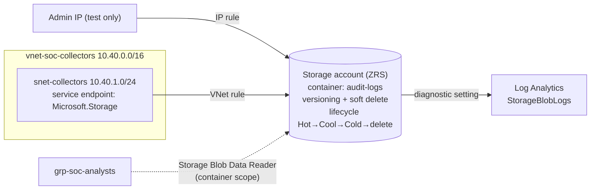

# Scenario 1: SOC audit-log storage

**AZ-104 domains:** Storage (primary) · Identities and governance · Monitor and maintain
**Status:** Ready to deploy · **Estimated cost:** a few cents per hour (ZRS storage, Log Analytics ingestion)

## The scenario

Contoso's security operations centre (SOC) exports authentication and firewall logs every hour. Auditors require that:

| # | Requirement |
|---|-------------|
| R1 | Logs survive the loss of a datacenter (zone) in the region |
| R2 | No anonymous access and no account keys: every request is tied to an Entra identity |
| R3 | Only the log-collector subnet (and the admin's IP for testing) can reach the account |
| R4 | SOC analysts can read logs but not change or delete them |
| R5 | An overwritten or deleted log can be recovered for 30 days |
| R6 | Storage cost falls as logs age; logs are deleted after 2 years |
| R7 | Every read, write and delete on the logs is recorded and queryable |

## Design decisions

| Requirement | Decision | Why this and not the alternative |
|---|---|---|
| R1 | **Standard_ZRS** | ZRS survives a zone failure. GRS adds a second region we don't need, and plain LRS doesn't survive a zone loss. |
| R2 | `allowSharedKeyAccess: false`, `allowBlobPublicAccess: false`, TLS 1.2 | Disabling shared key blocks account keys and key-signed SAS, so only Entra ID (and user delegation SAS) work. |
| R3 | Firewall `defaultAction: Deny` + **service endpoint** on the collector subnet + one IP rule | Service endpoints are free and allow a subnet by name. IP rules only accept public IPs. A private endpoint would be the choice if on-premises access were required. |
| R4 | **Storage Blob Data Reader**, scoped to the **container**, for the analyst group | A data-plane role is needed to read blob contents; control-plane roles (Reader) can't. Container scope is least privilege. |
| R5 | **Versioning** + **blob soft delete (30 days)** + container soft delete | Versioning keeps every overwritten state; soft delete brings back deleted blobs and containers. |
| R6 | **Lifecycle policy:** Cool at 30 days, Cold at 90, delete at 730; old versions deleted at 90 | **Archive isn't supported on ZRS**, so the policy stops at Cold. That's a deliberate trade-off between R1 and the cheapest tier. |
| R7 | **Diagnostic setting** on the blob service → Log Analytics (StorageRead/Write/Delete) | Resource logs aren't stored anywhere unless a diagnostic setting exists. |

## Architecture



## How to run it

```bash
# In Azure Cloud Shell (Bash), from this folder
chmod +x *.sh
./deploy.sh      # what-if preview, then deployment
./verify.sh      # proves each requirement (wait a few minutes for RBAC first)
./cleanup.sh     # deletes the resource group
```

Files:
- [`main.bicep`](main.bicep) is the whole environment as code
- [`deploy.sh`](deploy.sh) creates the reader group, previews with what-if, then deploys
- [`verify.sh`](verify.sh) runs one test per requirement, including negative tests
- [`cleanup.sh`](cleanup.sh) removes everything

## Evidence checklist

Save screenshots or command output in `evidence/` (redact subscription IDs, tenant names, emails and IPs).

- [ ] `01-settings.png`: ZRS, shared key disabled, public access disabled, default action Deny (R1–R3)
- [ ] `02-networking.png`: firewall showing the collector subnet and one IP rule (R3)
- [ ] `03-rbac.png`: Storage Blob Data Reader on the container for the analyst group (R4)
- [ ] `04-versions.png`: two versions of the same blob after an overwrite (R5)
- [ ] `05-undelete.png`: blob deleted then recovered (R5)
- [ ] `06-lifecycle.png`: lifecycle rule Cool 30 / Cold 90 / delete 730 (R6)
- [ ] `07-negative-shared-key.png`: key-based access refused (R2)
- [ ] `08-storageblogs.png`: KQL query showing reads, writes and deletes with caller IP and auth type (R7)

## What I learned
_To fill in after the run._

## Skills demonstrated
Storage redundancy choice · storage firewall and service endpoints · disabling shared key · data-plane RBAC at container scope · blob versioning, soft delete and change feed · lifecycle management · diagnostic settings and KQL · Bicep (parameters, `uniqueString`, scoped role assignments, outputs) · what-if deployments
