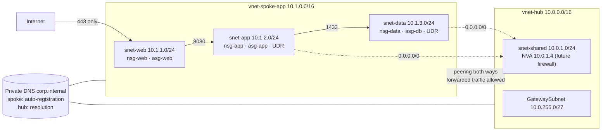

# Scenario 2: Hub-spoke network for a three-tier app

**AZ-104 domains:** Virtual networking (primary) · Monitor and maintain (Network Watcher)
**Status:** Ready to deploy · **Estimated cost:** free for the network; about US$0.01/hour if the optional B1s test VM is deployed

## The scenario

A retailer is moving its order system (web, app and database tiers) to Azure. The security team (that's the SOC) wants:

| # | Requirement |
|---|-------------|
| R1 | Shared services (future firewall, VPN gateway) live in one place; workloads live separately |
| R2 | Only HTTPS reaches the web tier from the internet |
| R3 | Web can talk only to app (8080); app only to database (1433). No tier skipping, no lateral movement |
| R4 | Rules must not break when servers are added or their IPs change |
| R5 | All internet-bound traffic from app and data tiers goes through the security appliance for inspection |
| R6 | Servers find each other by name, without anyone maintaining DNS records |

## Design decisions

| Requirement | Decision | Why this and not the alternative |
|---|---|---|
| R1 | **Hub-spoke**: `vnet-hub` 10.0.0.0/16 (shared + GatewaySubnet), `vnet-spoke-app` 10.1.0.0/16 | Shared services are deployed once and reused by every spoke. A flat VNet mixes workloads and makes blast radius hard to control. |
| R1 | **Peering in both directions**, `allowForwardedTraffic: true` | Peering is created per side; one side alone shows *Initiated*, not *Connected*. Forwarded traffic must be allowed for NVA-routed packets. Peering is **not transitive**: spoke-to-spoke needs the NVA or another peering. |
| R2, R3 | **One NSG per tier**, explicit allows, and a **deny at 4000** for other VNet traffic | The default `AllowVnetInBound` (65000) lets any VNet host in, **including peered VNets**. Without the explicit deny, web could reach the database directly. |
| R4 | **Application security groups** (`asg-web`, `asg-app`, `asg-db`) as rule sources/destinations | New NICs join an ASG and inherit the rules. IP-based rules break the moment a server is added or rebuilt. |
| R5 | **Route table** on app and data subnets: `0.0.0.0/0 → VirtualAppliance 10.0.1.4` | A UDR overrides Azure's default internet route. The web subnet keeps the default route so internet responses don't go asymmetric. BGP propagation is disabled so on-premises routes can't bypass the appliance. |
| R6 | **Private DNS zone** `corp.internal`, spoke linked with **auto-registration**, hub linked for resolution only | Auto-registration creates and removes VM A records automatically. A VNet can have auto-registration on only one private zone. |
| — | GatewaySubnet created now (/27) with **no NSG** | The name must be exactly `GatewaySubnet`; Microsoft recommends /27 or larger. Creating it now avoids re-addressing later. |

## Architecture



## How to run it

```bash
# In Azure Cloud Shell (Bash), from this folder
chmod +x *.sh
./deploy.sh                 # network only (free)
TEST_VM=true ./deploy.sh    # optional: adds a B1s VM in the app tier for Network Watcher tests
./verify.sh                 # peering, NSGs, routes, DNS; plus IP flow verify / next hop if the VM exists
./cleanup.sh
```

> **Note on the appliance:** 10.0.1.4 is a placeholder; no firewall is deployed (Azure Firewall costs about US$1.25/hour). Next hop will still show **VirtualAppliance 10.0.1.4**, which proves the route works. Real traffic to the internet from those subnets will be dropped until an appliance exists. That's the expected, safe failure.

## Evidence checklist

Save to `evidence/` (redact subscription IDs and tenant names).

- [ ] `01-peering.png`: both peerings **Connected**, forwarded traffic allowed (R1)
- [ ] `02-nsg-rules.png`: NSG rules referencing ASGs, including the 4000 deny (R2–R4)
- [ ] `03-route-table.png`: 0.0.0.0/0 → VirtualAppliance, associated with app and data subnets (R5)
- [ ] `04-dns-links.png`: spoke link with auto-registration, hub link without (R6)
- [ ] `05-dns-record.png`: vm-app01 A record created automatically (R6, needs test VM)
- [ ] `06-ip-flow-verify.png`: allowed and denied results with the rule name (R3, needs test VM)
- [ ] `07-next-hop.png`: next hop VirtualAppliance 10.0.1.4 for 8.8.8.8 (R5, needs test VM)
- [ ] `08-effective-routes.png`: effective routes showing the user route overriding the default (R5)

## Troubleshooting notes (what I'd check first)

| Symptom | First check |
|---|---|
| Peering shows *Initiated* | The other side's peering hasn't been created |
| Spoke VM can't reach a second spoke | Peering isn't transitive; route through the hub NVA |
| Traffic allowed that shouldn't be | The default `AllowVnetInBound` rule; look at **effective security rules** on the NIC |
| VM has no internet after adding the UDR | Expected until the NVA exists; check **next hop** |
| DNS name not resolving from the hub | Hub must be linked to the zone (registration not needed) |

## What I learned
_To fill in after the run._

## Skills demonstrated
Hub-spoke design · VNet peering (bidirectional, forwarded traffic, gateway transit) · NSGs and default-rule gotchas · application security groups · user-defined routes and BGP propagation · Azure private DNS with auto-registration · Network Watcher (IP flow verify, next hop, effective routes) · Bicep conditional resources
