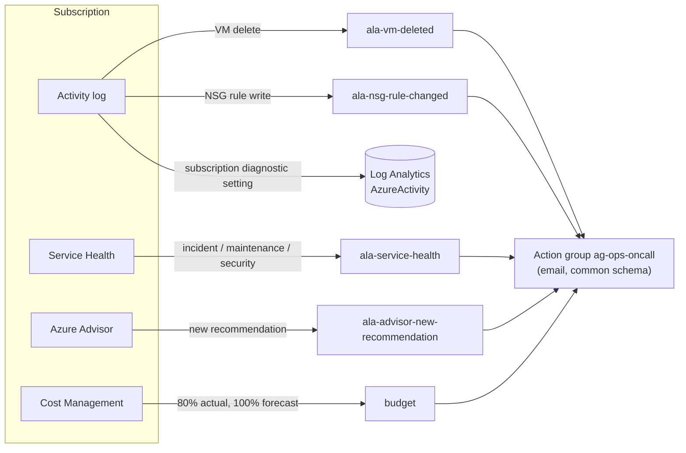

# Scenario 3: Production monitoring baseline

**AZ-104 domains:** Monitor and maintain (primary) · Identities and governance (cost management)
**Status:** Ready to deploy · **Estimated cost:** alerts, action groups and budgets are free; Log Analytics charges per GB ingested (the activity log is a few MB a day)

## The scenario

A small company's Azure subscription has no monitoring. Last month a developer deleted a VM by mistake and nobody noticed for two days, someone opened SSH to the internet on an NSG, and the bill doubled. Management wants:

| # | Requirement |
|---|-------------|
| R1 | The on-call team is told immediately when a VM is deleted anywhere in the subscription |
| R2 | The security team is told when anyone changes an NSG rule |
| R3 | The team hears about Azure outages, planned maintenance and security advisories that affect *their* resources |
| R4 | New cost, security and reliability recommendations are not missed |
| R5 | Spending is tracked, with a warning before the monthly limit is reached |
| R6 | Control-plane history is kept longer than Azure's 90-day default and can be queried |
| R7 | Notification targets are defined once and reused |

## Design decisions

| Requirement | Decision | Why this and not the alternative |
|---|---|---|
| R1, R2 | **Activity log alerts** on `virtualMachines/delete` and `securityRules/write`, scoped to the **subscription** | These are control-plane events, which live in the activity log. A metric alert can't see a delete, and a log search alert would add cost and delay. |
| R3 | **Service Health alert** (Incident, Maintenance, Security) | Service Health is personalised to the subscription's regions and services. The public Azure status page isn't. **Resource Health** is the per-resource view for "is *my* VM healthy?" |
| R4 | Activity log alert on the **Recommendation** category (Advisor) | Advisor publishes new recommendations to the activity log, so the same alert mechanism works. |
| R5 | **Budget** on the resource group: 80% actual and 100% **forecasted** | A budget **only notifies; it never stops resources**. Forecasted alerts give warning before the money is spent. Stopping resources would need an action group that runs automation. |
| R6 | **Subscription diagnostic setting** → Log Analytics (90-day retention, extendable) | The activity log is kept for 90 days only. Exporting makes it queryable with KQL (`AzureActivity`) and is the same data Sentinel's Azure Activity connector uses. |
| R7 | **One action group** (`ag-ops-oncall`) shared by every alert and the budget | Changing the on-call address happens in one place. Common alert schema keeps email and webhook payloads consistent. |

## Architecture



## How to run it

```bash
# In Azure Cloud Shell (Bash), from this folder
chmod +x *.sh
export ALERT_EMAIL=you@example.com     # keep this in a local env file, not in git
./deploy.sh
./verify.sh      # lists alerts, creates a test NSG rule to fire an alert, queries AzureActivity
./cleanup.sh     # also removes the subscription-level diagnostic setting
```

Files:
- [`main.bicep`](main.bicep) defines the workspace, action group, four activity log alerts and budget
- [`activity-log.bicep`](activity-log.bicep) is a **subscription-scope module** for the activity log export (a resource group deployment can't create a subscription diagnostic setting on its own)
- [`deploy.sh`](deploy.sh), [`verify.sh`](verify.sh) and [`cleanup.sh`](cleanup.sh)

## Evidence checklist

Save to `evidence/` (**redact the email address**, subscription IDs and tenant names).

- [ ] `01-alert-rules.png`: the four activity log alert rules, enabled (R1–R4)
- [ ] `02-action-group-test.png`: action group test succeeded (R7)
- [ ] `03-nsg-alert-email.png`: email received after the test NSG rule was created (R2)
- [ ] `04-fired-alert.png`: Monitor > Alerts showing the fired alert (R2)
- [ ] `05-budget.png`: budget with 80% actual and 100% forecasted thresholds (R5)
- [ ] `06-azureactivity-kql.png`: KQL query result from `AzureActivity` (R6)
- [ ] `07-service-health.png`: Service Health alert rule conditions (R3)

## Exam and real-world traps this covers

| Trap | Reality |
|---|---|
| "A budget will stop spending at the limit" | Budgets only alert. Stopping needs automation triggered by an action group. |
| "Use a metric alert to detect a deleted VM" | Deletes are control-plane events, so it's an activity log alert. |
| "Service Health and Resource Health are the same" | Service Health covers Azure-wide issues affecting you; Resource Health covers one resource. |
| "The activity log is kept forever" | 90 days, unless exported with a diagnostic setting. |
| "Deleting the resource group removes everything" | The subscription diagnostic setting lives outside the resource group. The cleanup script removes it explicitly. |

## What I learned
_To fill in after the run._

## Skills demonstrated
Activity log alerts · Service Health alerts · Advisor alerts · action groups and common alert schema · budgets (actual vs forecasted) · subscription diagnostic settings · KQL on `AzureActivity` · Bicep modules across scopes, `utcNow()` parameter defaults
