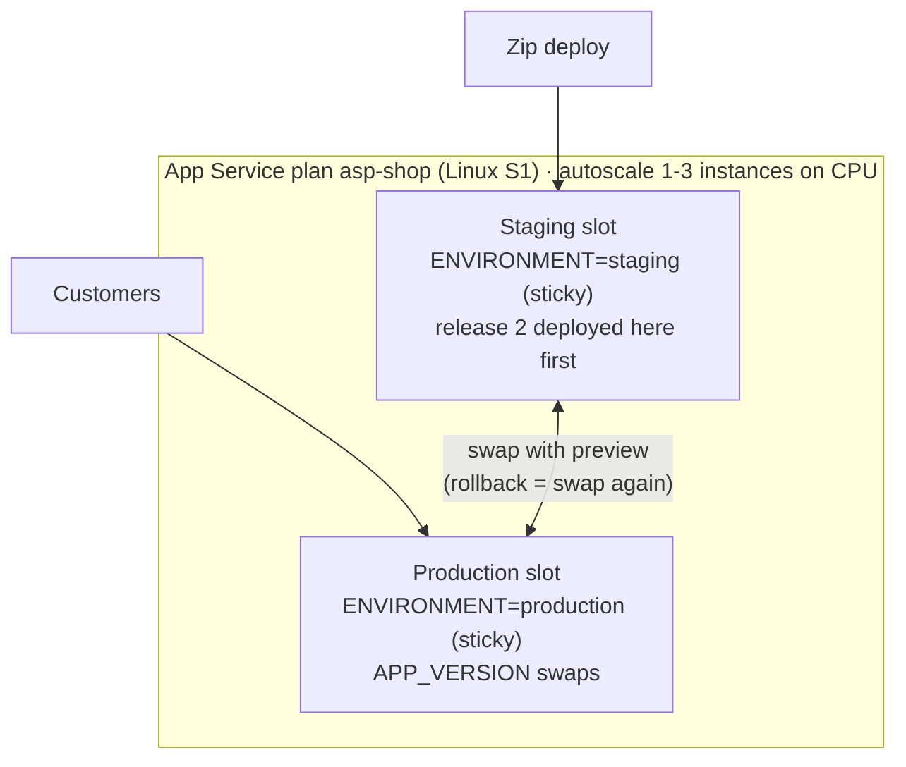

# Scenario 4: Zero-downtime releases with deployment slots and autoscale

**AZ-104 domains:** Compute (primary) · Monitor and maintain
**Status:** Ready to deploy · **Estimated cost:** about US$0.10 per hour on S1. Delete straight after testing.

## The scenario

An online shop releases a new checkout page. Last release, the site went down for 4 minutes during deployment and a staging connection string leaked into production. The business wants:

| # | Requirement |
|---|-------------|
| R1 | New releases go live with no downtime and can be rolled back in seconds |
| R2 | The new release can be tested with production settings before customers see it |
| R3 | Environment-specific settings never travel with the code during a release |
| R4 | The site handles a sale-day traffic spike without manual action, and the bill stays capped |
| R5 | HTTPS only, TLS 1.2 minimum, no FTP, no stored credentials |

## Design decisions

| Requirement | Decision | Why this and not the alternative |
|---|---|---|
| R1 | **Deployment slot** (`staging`) + **swap** | A swap redirects traffic between pre-warmed instances, so there's no cold start. Rolling back is just swapping again. Redeploying to production directly causes the restart we're trying to avoid. |
| R1, R4 | **Standard S1** plan | S1 is the cheapest tier with **both** slots and autoscale. Free/Shared/Basic have neither slots nor autoscale (Basic only scales manually). |
| R2 | **Swap with preview** (multi-phase swap) | Phase 1 applies production settings to the staging slot and warms it up; nothing is live yet. Phase 2 completes the swap. `--action reset` cancels. |
| R3 | `ENVIRONMENT` marked as a **deployment slot setting** (`slotConfigNames`) | Sticky settings stay with the slot; non-sticky settings (`APP_VERSION`) move with the code. This is the fix for the leaked connection string. |
| R4 | **Autoscale on the plan**: CPU > 70% for 10 min → +1, CPU < 30% → −1, min 1, max 3, 5 min cooldown | Scale-out happens at the **plan**, so every app in it scales together. The maximum caps cost. Scale-in rule is needed or it never shrinks back. |
| R5 | `httpsOnly`, `minTlsVersion 1.2`, `ftpsState Disabled`, **system-assigned managed identity** | The managed identity lets the app reach Key Vault or storage later with no secret in settings. |

## Architecture



## How to run it

```bash
# In Azure Cloud Shell (Bash), from this folder
chmod +x *.sh
./deploy.sh      # infra (what-if then deploy), release 1 to production, release 2 to staging
./verify.sh      # before/after, swap with preview, completes swap, shows autoscale
./cleanup.sh     # delete straight away; S1 bills while it exists
```

Files:
- [`main.bicep`](main.bicep) defines the plan, the app, the staging slot, sticky settings and autoscale
- [`site/v1`](site/v1) and [`site/v2`](site/v2) are two tiny PHP releases that print the settings they see
- [`deploy.sh`](deploy.sh), [`verify.sh`](verify.sh) and [`cleanup.sh`](cleanup.sh)

## What the swap proves

| | Before swap | After swap |
|---|---|---|
| **Production URL** | release 1 · ENVIRONMENT=production · APP_VERSION=v1 | **release 2** · ENVIRONMENT=**production** · APP_VERSION=**v2** |
| **Staging URL** | release 2 · ENVIRONMENT=staging · APP_VERSION=v2 | release 1 · ENVIRONMENT=staging · APP_VERSION=v1 |

`ENVIRONMENT` stayed put (sticky); `APP_VERSION` travelled with the code (not sticky).

## Evidence checklist

Save to `evidence/` (redact subscription IDs, tenant names and emails).

- [ ] `01-before.png`: production and staging side by side before the swap
- [ ] `02-slot-settings.png`: portal Configuration showing "Deployment slot setting" ticked for ENVIRONMENT
- [ ] `03-preview.png`: staging showing release 2 with production settings during preview
- [ ] `04-after.png`: production on release 2 with ENVIRONMENT still production
- [ ] `05-autoscale.png`: autoscale rules on the plan (scale out and scale in)
- [ ] `06-activity-log.png`: activity log showing the swap operations

## What I learned
_To fill in after the run._

## Skills demonstrated
App Service plan tiers and what each unlocks · deployment slots · sticky vs swapped settings · multi-phase swap and rollback · autoscale rules and cooldowns · zip deploy · managed identity · App Service hardening · Bicep (child resources, `slotConfigNames`, outputs)
